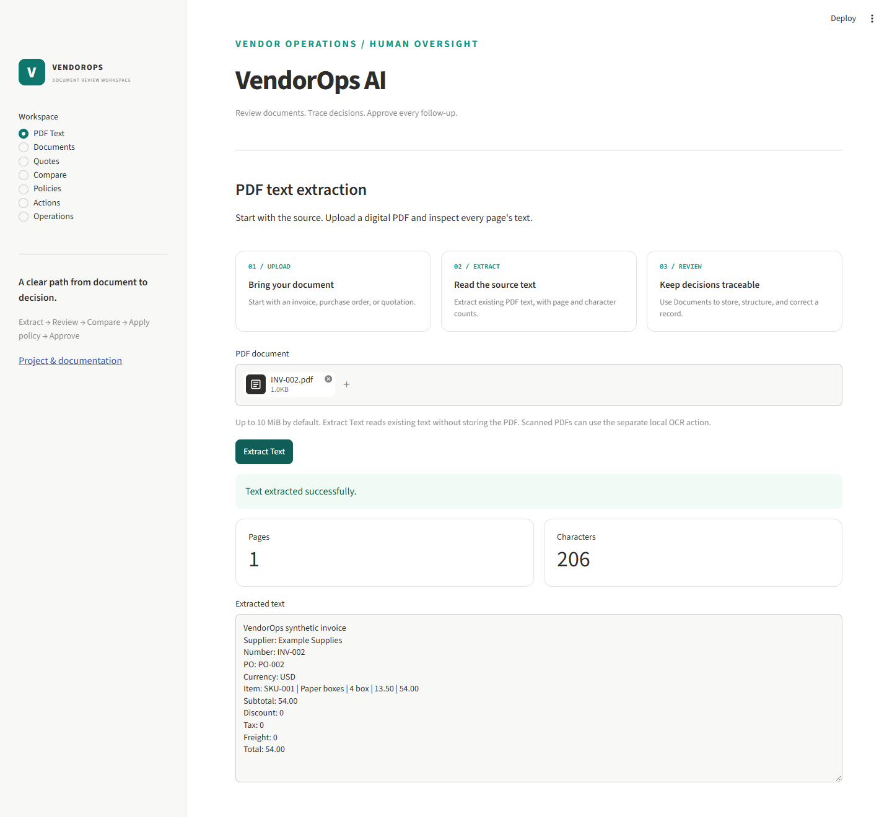
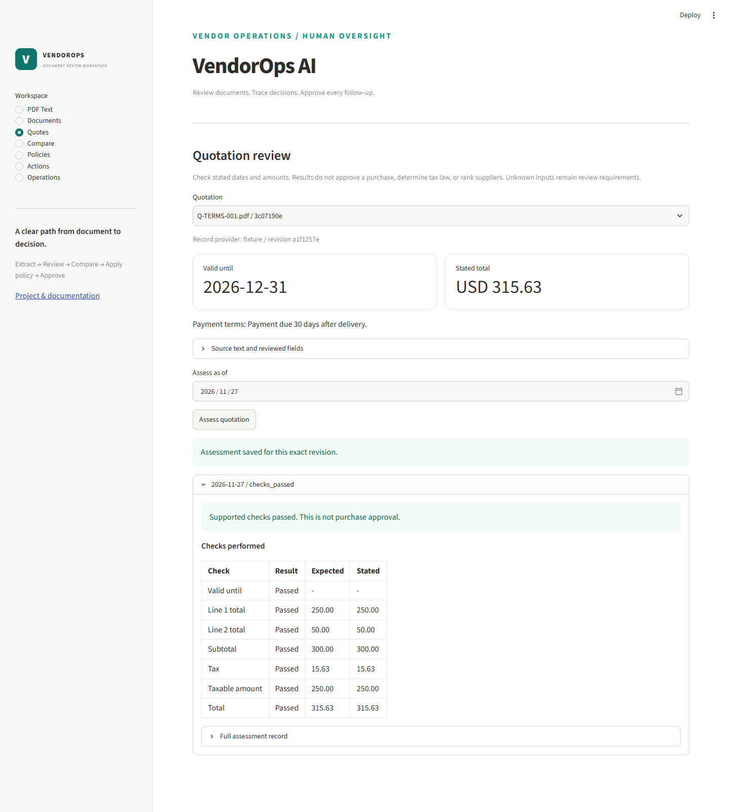
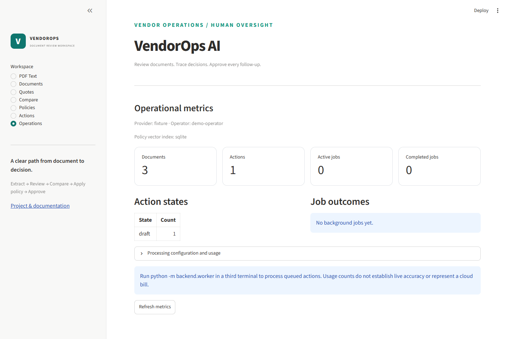
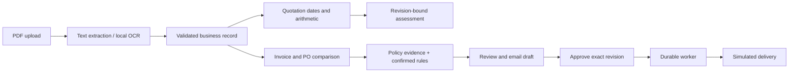

<p align="center">
  
</p>

<p align="center">
  <a href="https://github.com/surajnair17/vendorops-ai/actions/workflows/test.yml"></a>
  
  
  
  <a href="backend/docs/release-notes.md"></a>
</p>

<p align="center">
  <a href="#see-it-in-action">Demo video</a> ·
  <a href="#quick-start">Run locally</a> ·
  <a href="#how-it-works">Architecture</a> ·
  <a href="#verification-and-current-scope">Verification</a> ·
  <a href="backend/docs/README.md">Documentation</a> ·
  <a href="backend/docs/learning.md">Learn</a>
</p>

## Vendor documents. Decisions you can explain.

**VendorOps AI is a Python workspace for reviewing invoices, purchase orders, and quotations.**
Read digital and scanned PDFs, check financial differences, retrieve purchasing-policy evidence,
and approve a follow-up with a traceable history. Built with FastAPI, Streamlit, and SQLite.

**The example:** a purchase order says **$12.50** per box; the invoice says **$13.50**.
Python calculates the **8% variance**, a confirmed policy sets a **5% tolerance**, and the operator
reviews the evidence before approving a corrected-invoice request.

> **Try it without AWS credentials.** The local demo uses real PDF parsing and Tesseract OCR,
> fixture AI responses, and simulated email. Live calls are off by default. This is a private-demo
> portfolio PoC; [live AWS results and remaining gates](backend/docs/live-verification.md) are documented separately.

**Start here:** [Watch the walkthrough](#see-it-in-action) · [Run the app](#quick-start) ·
[Inspect the engineering](backend/docs/architecture.md) · [Check the evidence](backend/docs/status.md)

**Portfolio demo release:** [What's included](backend/docs/release-notes.md) ·
[Download a versioned snapshot](https://github.com/surajnair17/vendorops-ai/releases/tag/v0.1.0-demo).
The local workflow is ready to explore. Real S3 recovery and SES sending have been verified separately;
live AI and AWS hosting remain pending.

## See it in action

[](https://github.com/surajnair17/vendorops-ai/raw/refs/heads/main/backend/docs/assets/vendorops-demo.mp4)

**[Open the complete walkthrough · MP4 · 2 min 41 sec](https://github.com/surajnair17/vendorops-ai/raw/refs/heads/main/backend/docs/assets/vendorops-demo.mp4)**

| Read | Reason | Act |
| --- | --- | --- |
| Digital PDF → scanned-invoice OCR → reviewed fields | Invoice/PO difference → cited policy → confirmed tolerance | Edited draft → exact approval → simulated delivery → audit history |

The walkthrough also checks a quotation's expiry, payment terms, taxable amount, and totals.

The recording uses **real PDF parsing and local Tesseract OCR**, **fixture AI extraction and lexical
retrieval**, and **simulated email**. The scanned invoice is explicitly saved as a human-reviewed
revision. It uses synthetic documents throughout. [Chapters and evidence](backend/docs/demo.md#recorded-walkthrough)
· [Reproduce the recording](frontend/README.md#record-an-end-to-end-walkthrough).

<details>
<summary><strong>Explore the application screens</strong></summary>

Digital PDF upload and text extraction:



Source text and editable structured data, side by side:


Quotation dates, terms, tax, and arithmetic for the saved revision:



Counts from the running local demonstration:



</details>

The still screenshots use a separate seeded demo with an unapproved draft and no deliveries.
The video executes one approved simulated delivery. [Asset provenance](backend/docs/assets/README.md)
· [Reproduce the screenshots](frontend/README.md#preview-assets).

## What you can do

| Step | Capability |
| --- | --- |
| **Extract** | Read digital PDFs and run local Tesseract OCR on scanned pages. |
| **Review** | Inspect source text beside validated fields; retain corrections as new revisions. |
| **Assess quotes** | Review expiry and payment terms; check stated line totals, taxable amounts, tax, and totals. |
| **Compare** | Match an invoice to a purchase order and calculate differences with Python `Decimal`. |
| **Check policy** | Retrieve cited passages and apply only human-confirmed rules. |
| **Approve** | Edit a follow-up draft, approve its exact content, then explicitly execute delivery. |
| **Trace** | Inspect audit history, job outcomes, usage records, and evaluation results. |

### Engineering choices behind the workflow

- **Evidence travels with the result.** Field references, policy passages, and exact document revisions remain attached to findings.
- **Python calculates the money.** `Decimal` arithmetic and confirmed rules produce reproducible financial checks.
- **Approval follows the content.** Editing an email invalidates approval; source corrections make dependent reports stale.
- **Retries preserve uncertainty.** Durable jobs record delivery attempts; uncertain sends require reconciliation before another attempt.

## Quick start

Choose **Docker Compose** for the complete stack with Tesseract included, or **Python 3.13** for
native development. Run commands from the repository root.

```bash
git clone https://github.com/surajnair17/vendorops-ai.git
cd vendorops-ai
```

### Docker Compose

Copy `backend/.env.example` to `backend/.env` once, keeping its offline defaults. Then run:

```bash
docker compose -f backend/infra/compose.yaml up --build -d
```

Open **[the app](http://localhost:8501)** and **[API docs](http://127.0.0.1:8000/docs)**.
The stack starts the API, interface, and worker with shared persistent storage.
Stop it with `docker compose -f backend/infra/compose.yaml down`; this keeps the data volume.

### Native Python

Install Git and Python 3.13; Tesseract is needed only for OCR. Expand your platform's instructions:

<details>
<summary><strong>Windows / PowerShell</strong></summary>

Create an environment and install the application and test dependencies:

```powershell
python -m venv .venv
.\.venv\Scripts\python.exe -m pip install --require-hashes -r backend/requirements-lock.txt -r frontend/requirements-lock.txt
.\.venv\Scripts\python.exe -m pip install -r backend/requirements-dev.txt -r backend/requirements-cloud.txt -r frontend/requirements-dev.txt
Copy-Item backend/.env.example backend/.env
Copy-Item frontend/.env.example frontend/.env
```

Start these processes in **three separate terminals**, each at the repository root:

```powershell
# Terminal 1 — API
.\.venv\Scripts\python.exe -m uvicorn backend.main:app --host 127.0.0.1 --port 8000

# Terminal 2 — application
.\.venv\Scripts\python.exe -m streamlit run frontend/app.py --server.address 127.0.0.1

# Terminal 3 — background jobs
.\.venv\Scripts\python.exe -m backend.worker
```

Explicit interpreter paths work without activating the environment or changing PowerShell policies.
Copy configuration files only on first setup; preserve an existing `.env`.

</details>

<details>
<summary><strong>macOS / Linux</strong></summary>

```bash
python3.13 -m venv .venv
.venv/bin/python -m pip install --require-hashes -r backend/requirements-lock.txt -r frontend/requirements-lock.txt
.venv/bin/python -m pip install -r backend/requirements-dev.txt -r backend/requirements-cloud.txt -r frontend/requirements-dev.txt
cp -n backend/.env.example backend/.env
cp -n frontend/.env.example frontend/.env
```

In three separate terminals at the repository root:

```bash
# Terminal 1 — API
.venv/bin/python -m uvicorn backend.main:app --host 127.0.0.1 --port 8000

# Terminal 2 — application
.venv/bin/python -m streamlit run frontend/app.py --server.address 127.0.0.1

# Terminal 3 — background jobs
.venv/bin/python -m backend.worker
```

</details>

Open **[the application](http://localhost:8501)** or **[interactive API docs](http://127.0.0.1:8000/docs)**.
The worker processes OCR and approved delivery jobs. Press `Ctrl+C` in each terminal to stop.

### Try the guided demo

With the Docker stack running, seed the example through the API:

```bash
docker compose -f backend/infra/compose.yaml exec backend python -m backend.scripts.demo
```

For a native installation, open another terminal with the API running:

```powershell
.\.venv\Scripts\python.exe -m backend.scripts.generate_samples
.\.venv\Scripts\python.exe -m backend.scripts.demo
```

On macOS/Linux, use `.venv/bin/python` in place of the Windows interpreter path.
Native sample PDFs appear in `backend/artifacts/samples/`. The seeder creates a purchase order, an invoice with
a price difference, an inactive policy, an unconfirmed rule, and an **unapproved** email draft.
Follow **Documents → Compare → Policies → Actions**. See the [demo script](backend/docs/demo.md)
for a ten-minute walkthrough.

To capture the full flow as a captioned MP4, follow the
[browser recording instructions](frontend/README.md#record-an-end-to-end-walkthrough).

For quotation review, upload `backend/artifacts/samples/quotations/Q-TERMS-001.pdf` in Documents,
extract its fixture, then open **Quotes**. Set the assessment date to `2026-11-27` to check its
dates and amounts. Unfamiliar quotes can start with manually reviewed fields. See the
[quotation walkthrough](backend/docs/quotations.md) for supported formulas and limitations.

### Local OCR and containers

For native OCR, install Tesseract with English language data and set
`VENDOROPS_TESSERACT_COMMAND` in `backend/.env` to its executable path when it is not on `PATH`.
Store a scan in Documents, request OCR, and let the worker process it. On PDF Text, an image-only
upload offers **Read scanned PDF with local OCR**; this separate action saves a review copy and
shows the recognized text after refreshing job status. The **Extract Text** operation and its
stateless API still return `no_text` for an image-only document.

Policy retrieval uses exact cosine search in SQLite. Chroma was removed after unpatched upstream
security advisories; existing installations should set `VENDOROPS_VECTOR_STORE=sqlite`, uninstall
`chromadb`, and rebuild policy indexes. [Hardening and migration](backend/docs/hardening.md).

See the [operations guide](backend/docs/operations.md) for container commands, backups, and restore.
Container builds and the workflow are checked by Linux CI.

## How it works



| Layer | Technology | Responsibility |
| --- | --- | --- |
| Interface | Streamlit, HTTPX | Uploads, review screens, approvals, metrics |
| API | FastAPI, Pydantic | HTTP contracts, validation, workflow entry points |
| Documents | PyMuPDF, Tesseract | Digital text and local scanned-page OCR |
| Business logic | Python, `Decimal` | Matching, arithmetic, confirmed policy rules |
| Persistence | SQLite, SQLAlchemy | Revisioned records, audit events, durable jobs |
| Retrieval | SQLite cosine search | Policy passage retrieval with stored citations |
| Optional cloud adapters | Bedrock, Titan, S3, SES, Textract | Live extraction, embeddings, storage, email, cloud OCR |

Fixture extraction recognizes exact generated examples; it does not invent records for unknown
documents. Fixture retrieval checks offline plumbing; live semantic quality remains unmeasured.
See [architecture and decisions](backend/docs/architecture.md) for the boundaries.

## Repository map

Application source stays in two folders. Root files contain shared project and tooling settings.

<details>
<summary><strong>Explore backend/ and frontend/</strong></summary>

```text
vendorops-ai/
├── backend/
│   ├── main.py              # FastAPI entry point
│   ├── worker.py            # Durable background job runner
│   ├── routes/              # API endpoints by business capability
│   ├── schemas/             # Validated document and response contracts
│   ├── services/            # Extraction, comparison, policies, workflows
│   ├── migrations/          # Versioned SQLite schema
│   ├── tests/               # API, financial, workflow, and recovery checks
│   ├── scripts/             # Demo, sample generation, evaluation, backup
│   ├── docs/                # Documentation hub and presentation assets
│   └── infra/               # Docker Compose and deployment templates
├── frontend/
│   ├── app.py               # Navigation and entry point
│   ├── client.py            # HTTP boundary and readable error handling
│   ├── ui.py                # Shared visual shell
│   ├── views/               # One module per workspace screen
│   ├── assets/              # Shared presentation styles
│   ├── scripts/             # Browser screenshots and end-to-end recordings
│   └── tests/               # Streamlit checks
├── .github/                 # CI and contribution templates
├── AGENTS.md                # Coding-agent project instructions
├── pyproject.toml           # Shared pytest and Ruff configuration
└── README.md
```

Each application folder owns its dependencies, configuration example, Dockerfile, and README.
Runtime data, PDFs, credentials, local configuration, and generated reports are excluded from Git.

</details>

## Verification and current scope

```powershell
.\.venv\Scripts\python.exe -m pytest -q
.\.venv\Scripts\python.exe -m ruff check .
.\.venv\Scripts\python.exe -m backend.scripts.smoke
```

**Verified November 28, 2026:** 150 Python tests, Ruff lint/formatting, a Chrome walkthrough,
a 390px mobile layout check, and the Linux container workflow passed.
[CI run](https://github.com/surajnair17/vendorops-ai/actions/runs/46069042058) ·
[Hardening evidence](backend/docs/hardening.md) · [Evaluation methodology](backend/docs/evaluation.md).

The smoke harness starts real servers, uploads a PDF through Streamlit, visits every workspace
screen, and exercises approved **simulated** delivery using an isolated database.
[Evaluation commands and methodology](backend/docs/evaluation.md) cover fixture, OCR, and live-result scoring.

| Area | Status |
| --- | --- |
| Local review workflow, comparisons, policies, simulated actions, audit, backup/restore | Implemented and tested |
| Local OCR | Tested on a small synthetic corpus; customer-scan accuracy is unverified |
| Quotation fields and deterministic assessments | Implemented locally; ranking and live extraction accuracy remain unverified |
| Bedrock extraction and Titan embeddings | Adapters and read-only preflight implemented; live attempts blocked by zero regional inference quotas |
| SES approval and delivery | One real approved send received in Gmail Spam; inbox placement failed |
| S3 source storage and recovery | Real HTTP uploads, checksums, backup download, restoration, and resource cleanup verified |
| AWS host deployment | Template and preflight implemented; host not deployed while inference quotas block the full workflow |
| Learning exercises and teach-back | Intended for the learner to complete |

This is a **single-company, single-operator portfolio PoC**. It supports English documents and one
currency per document. Public access, multiple tenants, payment execution, ERP integration, currency
conversion, and cumulative partial-invoice accounting are outside this release.
Read the [verification record](backend/docs/status.md) before interpreting benchmark claims.
The [hardening report](backend/docs/hardening.md) covers request limits, crash recovery, verified
dependency locks, security checks, and the remaining release gates.

**Current cloud blocker:** sign-in and model access were verified in `ap-southeast-2`, but applied
Nova Lite and Titan inference quotas were zero. Three runtime attempts were throttled. A read-only
preflight now blocks further live recordings before inference when quotas are unavailable. The
Free plan remains selected. [AWS setup and quota checks](backend/docs/aws-setup.md#5-verify-each-live-service-separately).
The separate live S3 and SES checks passed; they do not establish live model accuracy.
The subsequent [Mumbai and Hyderabad review](backend/docs/live-verification.md#regional-alternatives-reviewed)
did not establish a usable replacement configuration. Sydney remains selected; no plan upgrade or
Region migration was performed.

## Explore further

| I want to… | Start here |
| --- | --- |
| Find the right guide | [Documentation hub](backend/docs/README.md) |
| Understand the backend | [Backend guide](backend/README.md) |
| Work on a screen | [Frontend guide](frontend/README.md) |
| Learn while building | [Workbook](backend/docs/learning.md) · [Phase roadmap](backend/docs/roadmap.md) |
| Try the HTTP contract | [API examples](backend/docs/api.md) |
| Watch or run a portfolio walkthrough | [Download video](https://github.com/surajnair17/vendorops-ai/raw/refs/heads/main/backend/docs/assets/vendorops-demo.mp4) · [Demo guide](backend/docs/demo.md) |
| Prepare optional cloud verification | [AWS setup](backend/docs/aws-setup.md) · [Cost worksheet](backend/docs/costs.md) |
| Make a change | [Contributing](.github/CONTRIBUTING.md) |

Built by [Suraj Nair](https://github.com/surajnair17) as a practical Python backend and document-AI learning project.

Feedback and contributions are welcome. [Report a reproducible issue](https://github.com/surajnair17/vendorops-ai/issues/new/choose),
[suggest a workflow improvement](https://github.com/surajnair17/vendorops-ai/issues/new?template=feature_request.yml),
or start with the [contribution guide](.github/CONTRIBUTING.md). Use synthetic documents in public examples.
