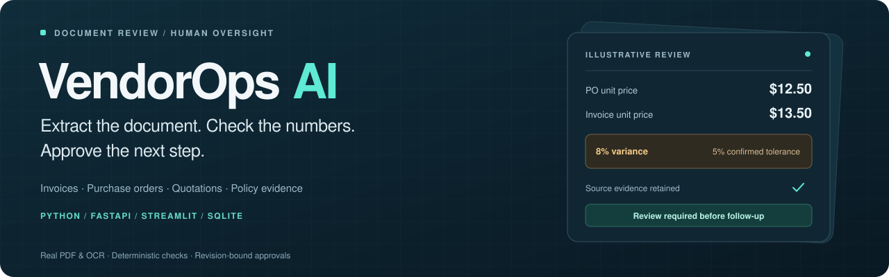
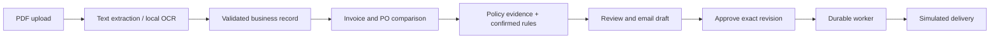

<p align="center">
  
</p>

<p align="center">
  <a href="https://github.com/surajnair17/vendorops-ai/actions/workflows/test.yml"></a>
  
  
  
  
</p>

<p align="center">
  <a href="#quick-start">Quick start</a> ·
  <a href="#see-it-in-action">Screenshots</a> ·
  <a href="#how-it-works">Architecture</a> ·
  <a href="backend/docs/README.md">Documentation</a> ·
  <a href="backend/docs/learning.md">Learning workbook</a>
</p>

VendorOps AI helps an operator review vendor documents, compare invoices with purchase orders,
check purchasing policies, and approve follow-up emails. It keeps source evidence, numerical
checks, and human decisions connected throughout the workflow.

**Run the local demo without AWS credentials.** It uses synthetic documents, deterministic extraction
fixtures, local storage, and simulated email. Live services and real sending are disabled by default.

## What you can do

| Step | Capability |
| --- | --- |
| **Extract** | Read digital PDFs; request local Tesseract OCR for scanned pages. |
| **Review** | Inspect source text alongside validated fields; retain every correction as a revision. |
| **Compare** | Match an invoice to a purchase order and calculate differences with Python `Decimal`. |
| **Check policy** | Retrieve cited passages and apply only human-confirmed rules. |
| **Approve** | Edit a follow-up draft, approve its exact content, then explicitly execute delivery. |
| **Trace** | Inspect audit history, job outcomes, usage records, and evaluation results. |

Ambiguous matches require review. Editing a source document makes dependent reports stale;
editing an email invalidates its approval. An uncertain delivery outcome requires reconciliation.

## See it in action


<details>
<summary><strong>Document review and operational metrics</strong></summary>

Source text and editable structured data, side by side:


Counts from the running local demonstration:


</details>

These are screenshots of the running application using synthetic data. PDF text comes from actual
PDF bytes; structured business extraction uses fixtures. The draft is unapproved and no email has
been sent. [Reproduce the screenshots](frontend/README.md#preview-assets).

## Quick start

**Prerequisites:** Git and Python 3.13. Run all commands from the repository root. Docker is optional;
Tesseract is needed only for local OCR.

```bash
git clone https://github.com/surajnair17/vendorops-ai.git
cd vendorops-ai
```

<details open>
<summary><strong>Windows / PowerShell</strong></summary>

Create an environment and install the application and test dependencies:

```powershell
python -m venv .venv
.\.venv\Scripts\python.exe -m pip install -r backend/requirements-dev.txt -r backend/requirements-cloud.txt -r frontend/requirements-dev.txt
Copy-Item backend/.env.example backend/.env
Copy-Item frontend/.env.example frontend/.env
```

Start these processes in **three separate terminals**, each at the repository root:

```powershell
# Terminal 1 — API
.\.venv\Scripts\python.exe -m uvicorn backend.main:app --host 127.0.0.1 --port 8000

# Terminal 2 — application
.\.venv\Scripts\python.exe -m streamlit run frontend/app.py --server.address 127.0.0.1

# Terminal 3 — background jobs
.\.venv\Scripts\python.exe -m backend.worker
```

Explicit interpreter paths work without activating the environment or changing PowerShell policies.
Copy configuration files only on first setup; preserve an existing `.env`.

</details>

<details>
<summary><strong>macOS / Linux</strong></summary>

```bash
python3.13 -m venv .venv
.venv/bin/python -m pip install -r backend/requirements-dev.txt -r backend/requirements-cloud.txt -r frontend/requirements-dev.txt
cp -n backend/.env.example backend/.env
cp -n frontend/.env.example frontend/.env
```

In three separate terminals at the repository root:

```bash
# Terminal 1 — API
.venv/bin/python -m uvicorn backend.main:app --host 127.0.0.1 --port 8000

# Terminal 2 — application
.venv/bin/python -m streamlit run frontend/app.py --server.address 127.0.0.1

# Terminal 3 — background jobs
.venv/bin/python -m backend.worker
```

</details>

Open **[the application](http://localhost:8501)** or **[interactive API docs](http://127.0.0.1:8000/docs)**.
The worker processes OCR and approved delivery jobs. Press `Ctrl+C` in each terminal to stop.

### Try the guided demo

With the API running, open another terminal:

```powershell
.\.venv\Scripts\python.exe -m backend.scripts.generate_samples
.\.venv\Scripts\python.exe -m backend.scripts.demo
```

On macOS/Linux, use `.venv/bin/python` in place of the Windows interpreter path.
Samples appear in `backend/artifacts/samples/`. The seeder creates a purchase order, an invoice with
a price difference, an inactive policy, an unconfirmed rule, and an **unapproved** email draft.
Follow **Documents → Compare → Policies → Actions**. See the [demo script](backend/docs/demo.md)
for a ten-minute walkthrough.

### Local OCR and containers

For native OCR, install Tesseract with English language data and set
`VENDOROPS_TESSERACT_COMMAND` in `backend/.env` to its executable path when it is not on `PATH`.
Store a scan in Documents, request OCR, and let the worker process it. PDF Text remains stateless
and returns `no_text` for an image-only document.

The backend container includes Tesseract. After creating `backend/.env`, an alternative local start is:

```bash
docker compose -f backend/infra/compose.yaml up --build -d
```

This starts the API, frontend, worker, and Chroma. See the [operations guide](backend/docs/operations.md)
for stop, backup, and restore commands. Container builds and startup are checked by Linux CI.

## How it works



| Layer | Technology | Responsibility |
| --- | --- | --- |
| Interface | Streamlit, HTTPX | Uploads, review screens, approvals, metrics |
| API | FastAPI, Pydantic | HTTP contracts, validation, workflow entry points |
| Documents | PyMuPDF, Tesseract | Digital text and local scanned-page OCR |
| Business logic | Python, `Decimal` | Matching, arithmetic, confirmed policy rules |
| Persistence | SQLite, SQLAlchemy | Revisioned records, audit events, durable jobs |
| Retrieval | Chroma | Policy passage retrieval with stored citations |
| Optional cloud adapters | Bedrock, Titan, S3, SES, Textract | Live extraction, embeddings, storage, email, cloud OCR |

Fixture extraction recognizes exact generated examples; it does not invent records for unknown
documents. Fixture retrieval checks offline plumbing; live semantic quality remains unmeasured.
See [architecture and decisions](backend/docs/architecture.md) for the boundaries.

## Repository map

Application source stays in two folders. Root files contain shared project and tooling settings.

```text
vendorops-ai/
├── backend/
│   ├── main.py              # FastAPI entry point
│   ├── worker.py            # Durable background job runner
│   ├── routes/              # API endpoints by business capability
│   ├── schemas/             # Validated document and response contracts
│   ├── services/            # Extraction, comparison, policies, workflows
│   ├── migrations/          # Versioned SQLite schema
│   ├── tests/               # API, financial, workflow, and recovery checks
│   ├── scripts/             # Demo, sample generation, evaluation, backup
│   ├── docs/                # Documentation hub and presentation assets
│   └── infra/               # Docker Compose and deployment templates
├── frontend/
│   ├── app.py               # Navigation and entry point
│   ├── client.py            # HTTP boundary and readable error handling
│   ├── ui.py                # Shared visual shell
│   ├── views/               # One module per workspace screen
│   ├── assets/              # Shared presentation styles
│   ├── scripts/             # Reproducible screenshot capture
│   └── tests/               # Streamlit checks
├── .github/                 # CI and contribution templates
├── AGENTS.md                # Coding-agent project instructions
├── pyproject.toml           # Shared pytest and Ruff configuration
└── README.md
```

Each application folder owns its dependencies, configuration example, Dockerfile, and README.
Runtime data, PDFs, credentials, local configuration, and generated reports are excluded from Git.

## Verification and current scope

```powershell
.\.venv\Scripts\python.exe -m pytest -q
.\.venv\Scripts\python.exe -m ruff check .
.\.venv\Scripts\python.exe -m backend.scripts.smoke
```

The smoke harness starts real servers, uploads a PDF through Streamlit, visits every workspace
screen, and exercises approved **simulated** delivery using an isolated database.
[Evaluation commands and methodology](backend/docs/evaluation.md) cover fixture, OCR, and live-result scoring.

| Area | Status |
| --- | --- |
| Local review workflow, comparisons, policies, simulated actions, audit, backup/restore | Implemented and tested |
| Local OCR | Tested on a small synthetic corpus; customer-scan accuracy is unverified |
| Cloud adapters and deployment templates | Implemented; live deployment, model quality, and inbox delivery remain unverified |
| Learning exercises and teach-back | Intended for the learner to complete |

This is a **single-company, single-operator portfolio PoC**. It supports English documents and one
currency per document. Public access, multiple tenants, payment execution, ERP integration, currency
conversion, and cumulative partial-invoice accounting are outside this release.
Read the [verification record](backend/docs/status.md) before interpreting benchmark claims.

## Explore further

| I want to… | Start here |
| --- | --- |
| Find the right guide | [Documentation hub](backend/docs/README.md) |
| Understand the backend | [Backend guide](backend/README.md) |
| Work on a screen | [Frontend guide](frontend/README.md) |
| Learn while building | [Workbook](backend/docs/learning.md) · [Phase roadmap](backend/docs/roadmap.md) |
| Try the HTTP contract | [API examples](backend/docs/api.md) |
| Run a portfolio walkthrough | [Demo script](backend/docs/demo.md) |
| Prepare optional cloud verification | [AWS setup](backend/docs/aws-setup.md) · [Cost worksheet](backend/docs/costs.md) |
| Make a change | [Contributing](.github/CONTRIBUTING.md) |

Built by [Suraj Nair](https://github.com/surajnair17) as a practical Python backend and document-AI learning project.
