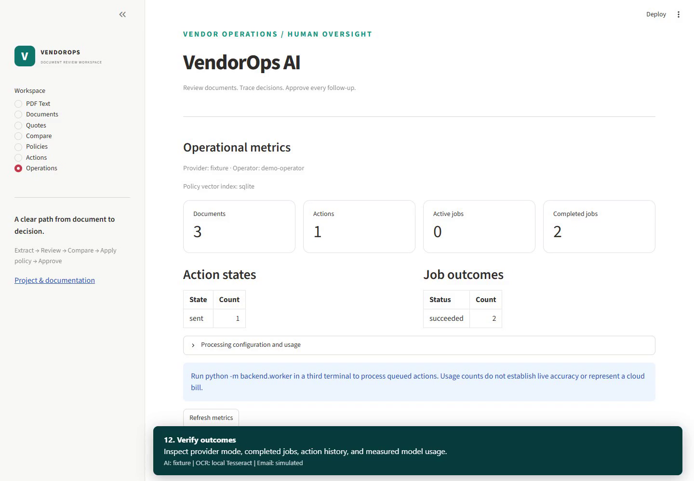
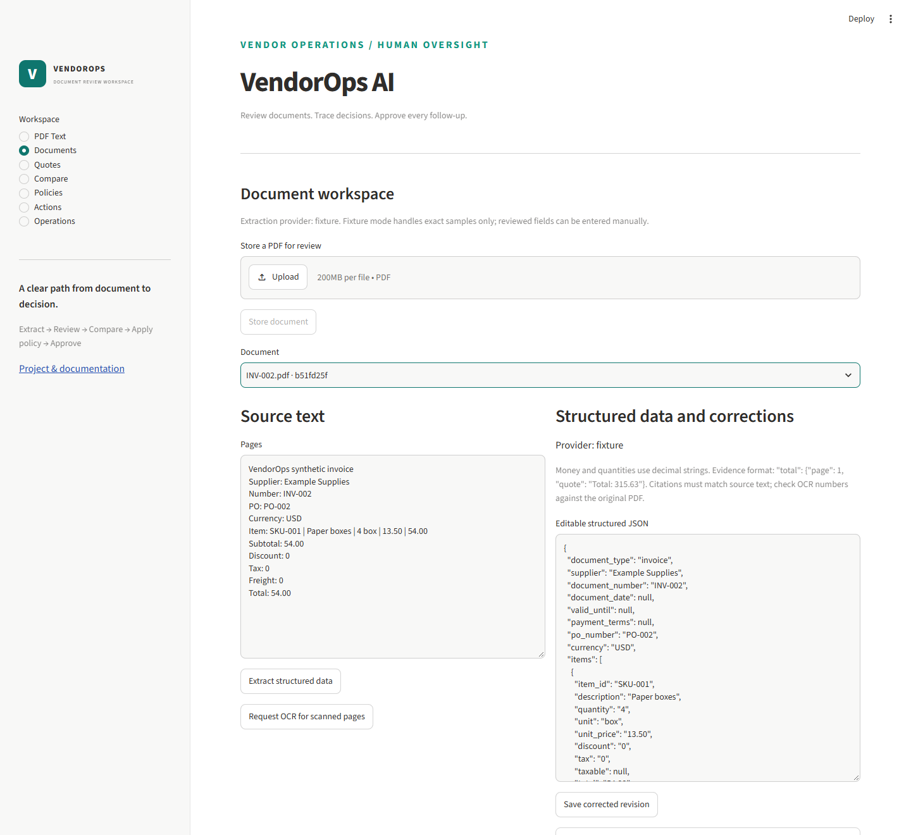
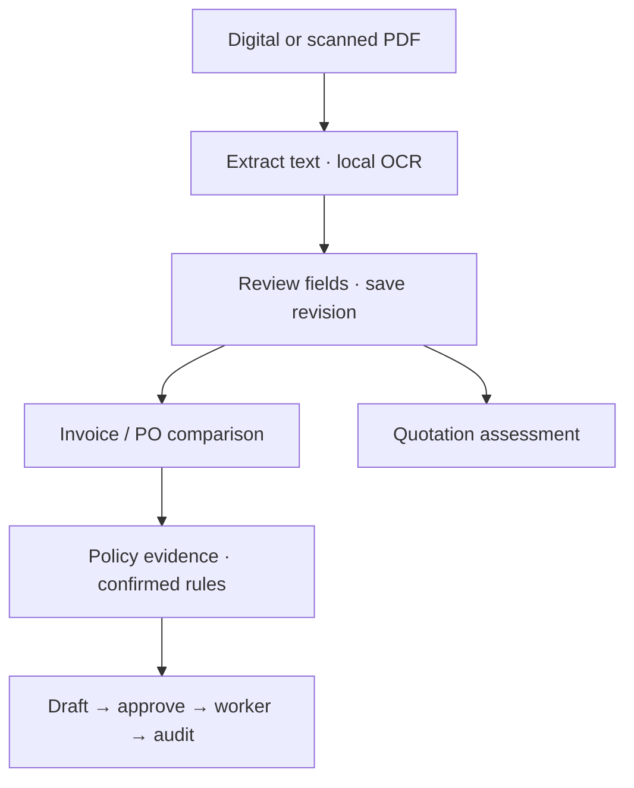

<p align="center">
  
</p>

<p align="center">
  <strong>A document review workspace for purchasing teams.</strong><br>
  Turn invoices, purchase orders, and quotations into evidence you can review and decisions you can trace.
</p>

<p align="center">
  <a href="https://github.com/surajnair17/vendorops-ai/actions/workflows/test.yml"></a>
  <a href="https://github.com/surajnair17/vendorops-ai/releases/tag/v0.1.0-demo"></a>
  
  
  
</p>

<p align="center">
  <a href="#see-it-in-action"><strong>Watch the demo</strong></a> &nbsp;·&nbsp;
  <a href="#quick-start"><strong>Run locally</strong></a> &nbsp;·&nbsp;
  <a href="backend/docs/README.md"><strong>Read the docs</strong></a> &nbsp;·&nbsp;
  <a href="https://github.com/surajnair17/vendorops-ai/releases/tag/v0.1.0-demo"><strong>Get the release</strong></a>
</p>

---

## From paperwork to a reviewed next step

A supplier invoices **$13.50 per box** against a purchase order for **$12.50**.
VendorOps calculates the **8% difference**, checks it against a human-confirmed **5% tolerance**,
and prepares the evidence for review before a follow-up is approved.

| 01 · Read | 02 · Check | 03 · Act |
| :--- | :--- | :--- |
| Extract PDFs and scans. Review fields beside their source. | Compare prices and quantities. Check quote terms and policy evidence. | Edit a draft. Approve its exact revision. Track delivery and history. |

> [!NOTE]
> **Runs without AWS credentials.** The local demo uses real PDF parsing and Tesseract OCR,
> fixture AI responses, lexical policy retrieval, and simulated email. Live AI and AWS hosting
> remain pending. [Verified scope and cloud results](#verification-and-current-scope).

## See it in action

<p align="center">
  <a href="https://github.com/surajnair17/vendorops-ai/releases/download/v0.1.0-demo/vendorops-demo.mp4">
    
  </a>
</p>

<p align="center">
  <a href="https://github.com/surajnair17/vendorops-ai/releases/download/v0.1.0-demo/vendorops-demo.mp4"><strong>▶ Watch the complete workflow · 2 min 41 sec</strong></a><br>
  <sub>Captioned MP4 · Synthetic documents · Real local OCR · Fixture AI · Simulated delivery</sub>
</p>

The walkthrough covers a digital PO, scanned invoice, quotation checks, a cited policy, and one
approved follow-up. The scanned record is human-reviewed.
[Chapters and evidence](backend/docs/demo.md#recorded-walkthrough) ·
[Recording manifest](backend/docs/assets/demo-manifest.json).

<details>
<summary><strong>Explore the workspace — four application screens</strong></summary>

<table>
  <tr>
    <td width="50%" valign="top">
      <strong>Read the source</strong><br><sub>PDF text and document metrics.</sub><br><br>
      <a href="backend/docs/assets/extraction.png"></a>
    </td>
    <td width="50%" valign="top">
      <strong>Review the record</strong><br><sub>Source text beside editable fields.</sub><br><br>
      <a href="backend/docs/assets/document-review.png"></a>
    </td>
  </tr>
  <tr>
    <td width="50%" valign="top">
      <strong>Assess a quotation</strong><br><sub>Validity, terms, tax, and totals.</sub><br><br>
      <a href="backend/docs/assets/quotation-review.png"></a>
    </td>
    <td width="50%" valign="top">
      <strong>Follow the workflow</strong><br><sub>Documents, jobs, and action states.</sub><br><br>
      <a href="backend/docs/assets/operations.png"></a>
    </td>
  </tr>
</table>

Select any image to view it at full size. These screenshots use a separate seeded demo with an
unapproved draft and no deliveries. [Asset provenance](backend/docs/assets/README.md).

</details>

## What you can do

| Capability | What it gives the reviewer |
| :--- | :--- |
| **PDF + OCR** | Digital text and scanned-page OCR, with the source available for inspection. |
| **Structured review** | Validated fields, visible uncertainty, and corrections saved as new revisions. |
| **Invoice ↔ PO comparison** | Reproducible quantity, price, and total checks using Python `Decimal`. |
| **Quotation assessment** | Expiry, payment terms, stated tax, taxable amounts, and arithmetic checks. |
| **Policy evidence** | Cited passages and executable rules that require human confirmation. |
| **Approval workflow** | Editable drafts, exact-revision approval, durable jobs, and audit history. |

## Quick start

**Docker Compose** starts the API, interface, and worker with Tesseract included.
Run these commands from a terminal with Git and Docker installed:

```bash
git clone https://github.com/surajnair17/vendorops-ai.git
cd vendorops-ai
```

Copy `backend/.env.example` to `backend/.env` once, keeping its offline defaults.
Then start the stack and load the synthetic example:

```bash
docker compose -f backend/infra/compose.yaml up --build -d
docker compose -f backend/infra/compose.yaml exec backend python -m backend.scripts.demo
```

| Open | Address |
| :--- | :--- |
| **Application** | [localhost:8501](http://localhost:8501) |
| **Interactive API docs** | [127.0.0.1:8000/docs](http://127.0.0.1:8000/docs) |

Follow **Documents → Compare → Policies → Actions**. The seeded policy and rule require confirmation;
the draft starts **unapproved**. [Guided walkthrough](backend/docs/demo.md).

Stop with `docker compose -f backend/infra/compose.yaml down`. Your data volume is retained.
For a pinned snapshot, use the [demo release](https://github.com/surajnair17/vendorops-ai/releases/tag/v0.1.0-demo).

### Native Python


Install Git and Python 3.13; Tesseract is needed only for OCR. Expand your platform's instructions:

<details>
<summary><strong>Windows / PowerShell</strong></summary>

Create an environment and install the application and test dependencies:

```powershell
python -m venv .venv
.\.venv\Scripts\python.exe -m pip install --require-hashes -r backend/requirements-lock.txt -r frontend/requirements-lock.txt
.\.venv\Scripts\python.exe -m pip install -r backend/requirements-dev.txt -r backend/requirements-cloud.txt -r frontend/requirements-dev.txt
Copy-Item backend/.env.example backend/.env
Copy-Item frontend/.env.example frontend/.env
```

Start these processes in **three separate terminals**, each at the repository root:

```powershell
# Terminal 1 — API
.\.venv\Scripts\python.exe -m uvicorn backend.main:app --host 127.0.0.1 --port 8000

# Terminal 2 — application
.\.venv\Scripts\python.exe -m streamlit run frontend/app.py --server.address 127.0.0.1

# Terminal 3 — background jobs
.\.venv\Scripts\python.exe -m backend.worker
```

Explicit interpreter paths work without activating the environment or changing PowerShell policies.
Copy configuration files only on first setup; preserve an existing `.env`.

</details>

<details>
<summary><strong>macOS / Linux</strong></summary>

```bash
python3.13 -m venv .venv
.venv/bin/python -m pip install --require-hashes -r backend/requirements-lock.txt -r frontend/requirements-lock.txt
.venv/bin/python -m pip install -r backend/requirements-dev.txt -r backend/requirements-cloud.txt -r frontend/requirements-dev.txt
cp -n backend/.env.example backend/.env
cp -n frontend/.env.example frontend/.env
```

In three separate terminals at the repository root:

```bash
# Terminal 1 — API
.venv/bin/python -m uvicorn backend.main:app --host 127.0.0.1 --port 8000

# Terminal 2 — application
.venv/bin/python -m streamlit run frontend/app.py --server.address 127.0.0.1

# Terminal 3 — background jobs
.venv/bin/python -m backend.worker
```

</details>

Open **[the application](http://localhost:8501)** or **[interactive API docs](http://127.0.0.1:8000/docs)**.
The worker processes OCR and approved delivery jobs. Press `Ctrl+C` in each terminal to stop.

### Try the guided demo

For a native installation, keep the three processes running and open another terminal:

```powershell
.\.venv\Scripts\python.exe -m backend.scripts.generate_samples
.\.venv\Scripts\python.exe -m backend.scripts.demo
```

On macOS/Linux, use `.venv/bin/python`. Generated PDFs appear in `backend/artifacts/samples/`.
To explore quotations, upload `quotations/Q-TERMS-001.pdf` from that directory and follow the
[quotation walkthrough](backend/docs/quotations.md).

<details>
<summary><strong>Scanned PDFs, OCR setup, and existing installations</strong></summary>

For native OCR, install Tesseract with English language data. If it is not on `PATH`, set
`VENDOROPS_TESSERACT_COMMAND` in `backend/.env` to its executable path.

An image-only PDF returns `no_text` from the stateless **Extract Text** operation. Use the separate
**Read scanned PDF with local OCR** action, or request OCR from Documents; the worker processes
the saved review copy. Refresh job status to see the text.

Policy retrieval now uses SQLite cosine search. Existing Chroma installations should follow the
[migration guide](backend/docs/hardening.md). See [operations](backend/docs/operations.md) for
restart, backup, restoration, and container commands.

</details>

## How it works



| Layer | Built with |
| :--- | :--- |
| **Experience** | Streamlit · HTTPX |
| **API & validation** | FastAPI · Pydantic |
| **Documents & calculations** | PyMuPDF · Tesseract · Python `Decimal` |
| **State & retrieval** | SQLite · SQLAlchemy · cosine search |
| **Optional AWS adapters** | Bedrock · Titan embeddings · S3 · SES · Textract |

### Decisions that matter

- **Evidence stays attached.** Findings reference the exact source revisions and supporting passages.
- **Money is calculated in Python.** Financial checks use deterministic arithmetic and confirmed rules.
- **Approval follows the content.** Editing a draft invalidates approval; source corrections make dependent reports stale.
- **Uncertain delivery stays visible.** The worker records attempts and requires reconciliation before resending an uncertain action.

Fixture extraction recognizes exact generated examples; unknown documents do not receive invented
fixture records. [Architecture and boundaries](backend/docs/architecture.md).

## Repository map

```text
vendorops-ai/
├── backend/              FastAPI, business logic, persistence, worker
│   ├── routes/           HTTP endpoints
│   ├── schemas/          Validated contracts
│   ├── services/         Documents, comparisons, policies, actions
│   ├── tests/            API, financial, workflow, recovery checks
│   ├── scripts/          Samples, demo, evaluation, backup
│   ├── infra/            Docker Compose and AWS templates
│   └── docs/             Guides, evidence, screenshots, recording
├── frontend/             Streamlit workspace and HTTP client
│   ├── views/            Screens by workflow stage
│   ├── scripts/          Screenshots and browser recording
│   └── tests/            Interface checks
└── .github/              CI and contribution templates
```

Each application folder owns its dependencies, configuration example, and Dockerfile.
[Backend guide](backend/README.md) · [Frontend guide](frontend/README.md).

## Verification and current scope

| Area | Verified result |
| :--- | :--- |
| **Local workflow** | PDF/OCR, review, comparisons, policies, quotation checks, simulated actions, and recovery tested. |
| **CI** | Python tests, lint/formatting, dependency audit, HTTP/frontend smoke checks, offline evaluations, and Linux Compose runtime. |
| **Live S3** | Uploads, checksums, backup download, restoration, and test-resource cleanup verified. |
| **Live SES** | One approved sandbox email reached Gmail **Spam**; Inbox placement was not achieved. |
| **Live AI & hosting** | Bedrock adapters and deployment templates exist; model quotas block live AI verification, and the AWS host is not deployed. |

[Verification record](backend/docs/status.md) · [Live AWS evidence](backend/docs/live-verification.md) ·
[Release notes](backend/docs/release-notes.md) · [Evaluation methodology](backend/docs/evaluation.md).

<details>
<summary><strong>Run the local checks</strong></summary>

```powershell
.\.venv\Scripts\python.exe -m pytest -q
.\.venv\Scripts\python.exe -m ruff check .
.\.venv\Scripts\python.exe -m ruff format --check .
.\.venv\Scripts\python.exe -m backend.scripts.smoke
```

Use `.venv/bin/python` on macOS/Linux. The smoke harness starts real servers, uploads through the
interface, and exercises simulated delivery with isolated data. AWS Guard reports advisory findings;
a successful report job is not compliance certification. [Hardening evidence](backend/docs/hardening.md).

</details>

**Scope:** one company, one operator, English documents, and one currency per document. This is a
portfolio PoC. Customer-scan accuracy, live model quality, and multiuser operation are unverified.
Payments, ERP updates, public signup, quotation ranking, and cumulative fulfilment accounting are
outside this release. Live calls stay disabled by default.

Sydney remains selected after the [Mumbai and Hyderabad review](backend/docs/live-verification.md#regional-alternatives-reviewed).
The Free plan is unchanged; cloud results are documented separately from the local demo.

## Explore further

| Build understanding | Run and extend |
| :--- | :--- |
| [Architecture and decisions](backend/docs/architecture.md) | [API examples](backend/docs/api.md) |
| [Learning workbook](backend/docs/learning.md) | [Operations and recovery](backend/docs/operations.md) |
| [Phase-by-phase roadmap](backend/docs/roadmap.md) | [AWS setup and cost controls](backend/docs/aws-setup.md) |
| [Documentation hub](backend/docs/README.md) | [Contributing guide](.github/CONTRIBUTING.md) |

---

<p align="center">
  Built by <a href="https://github.com/surajnair17"><strong>Suraj Nair</strong></a><br>
  <sub>A practical project in Python backend engineering, document AI, and human-reviewed automation.</sub>
</p>

<p align="center">
  <a href="https://github.com/surajnair17/vendorops-ai/issues/new/choose">Report an issue</a> &nbsp;·&nbsp;
  <a href="https://github.com/surajnair17/vendorops-ai/issues/new?template=feature_request.yml">Suggest an improvement</a> &nbsp;·&nbsp;
  <a href=".github/CONTRIBUTING.md">Contribute</a>
</p>

<p align="center"><sub>Use synthetic documents in public examples. Credentials and private documents stay outside the repository.</sub></p>
