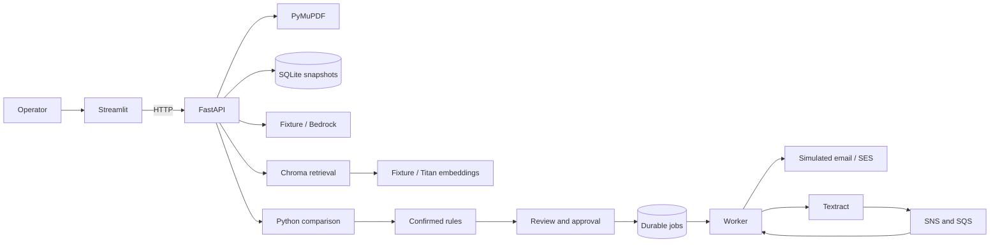

# Architecture and decisions

- Phase 1 remains stateless; persistent review uses separate endpoints.
- Source text, model output, and corrections are separate snapshots. Reports reference exact
  revisions. Staleness is checked again before approval and execution.
- Money uses Decimal and JSON decimal strings. Missing values stay null. A line total means
  quantity × price − line discount + line tax; subtotal sums line totals. Final total applies
  separately stated document discount/tax/freight. Other conventions need manual review.
- Automatic PO selection requires a unique reference plus supplier match. Repeated item identifiers
  need an explicit one-to-one mapping. Supplier aliases require human confirmation.
- Fixture embeddings hash words and are labelled lexical plumbing, not semantic accuracy.
  Real Titan embeddings use a separate collection; switching providers requires reindexing.
- Policy paragraphs are evidence, not executable instructions. Confirmed rules retain citations.
  Conflicts abstain; tolerances never delete the observed numerical difference.
- Editing an action clears approval. One durable outbox job prevents duplicate button-click sends.
  Uncertain delivery is reconciled by a human; SES acceptance is not proof of inbox arrival.
- The deployment is one private host and one operator. No public authentication, tenant isolation,
  high availability, payment processing, or compliance certification is claimed.

Read the PDF service and route first, then trace one structured field, one finding, one confirmed
rule, and one approved action. Inspect cloud adapters after understanding that local flow.
