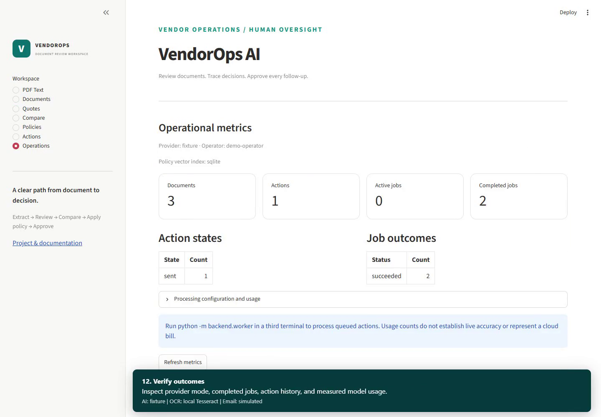

# Guided demonstration and learning checkpoints

## Recorded walkthrough

**[Open the captioned demo (MP4, 2 min 41 sec)](https://github.com/surajnair17/vendorops-ai/raw/refs/heads/main/backend/docs/assets/vendorops-demo.mp4)**

[](https://github.com/surajnair17/vendorops-ai/raw/refs/heads/main/backend/docs/assets/vendorops-demo.mp4)

Recorded from the actual local Streamlit application on **November 28, 2026**, after the hardening
release, using an isolated database and synthetic documents. It has on-screen chapter captions and
no audio. The quotation assessment deliberately uses the fixed example date **November 27, 2026**;
the opening card displays that assessment date.

| Approximate position | What happens |
| --- | --- |
| 00:00 | Introduce the workflow and declare fixture AI, real local OCR, and simulated email |
| 00:13 | Upload a digital invoice PDF and read its text over HTTP |
| 00:25 | Store and structure the synthetic purchase order |
| 00:35 | Upload an image-only invoice and run real Tesseract OCR |
| 00:47 | Correct uncertain OCR extraction as a human-reviewed revision |
| 00:54 | Detect the 12.50 → 13.50 unit-price difference |
| 01:06 | Index policy evidence, activate the policy, and confirm a 5% rule |
| 01:16 | Apply the confirmed rule while preserving the observed variance |
| 01:26 | Draft and edit a request for a corrected invoice |
| 01:39 | Approve the exact content revision, then execute the action |
| 01:52 | Inspect the single simulated delivery and approval history |
| 02:01 | Review a quotation's expiry, payment terms, tax, and totals |
| 02:18 | Verify three documents, two successful jobs, and one completed simulated action |

| Component | Evidence in this recording |
| --- | --- |
| Text and OCR | PyMuPDF reads actual PDF bytes; Tesseract recognizes a scanned page |
| Business extraction | Exact fixtures for the PO and quote; a human-reviewed revision for the OCR invoice |
| Comparison and rules | Python finds the 12.50 → 13.50 price difference and applies the confirmed tolerance |
| Policy search | Fixture lexical embeddings with SQLite cosine retrieval and stored citations |
| Delivery | One simulated attempt, bound to approval of the edited content revision |
| Quotation | Saved assessment reports `checks_passed` for supported dates and arithmetic |

This recording demonstrates local workflow behavior. The separate [live S3 and SES checks](live-verification.md)
are documented with their own evidence; the real email reached Gmail Spam. These checks are not shown
in this video. Live model accuracy, cloud deployment, and Inbox
placement remain unverified. The AWS inference attempt was throttled by zero regional quotas; see the
[verification record](status.md). The public [media manifest](assets/demo-manifest.json) records
provider modes, observed outcomes, and the video's SHA-256. Private source files and runtime logs
are excluded from the repository.

**Recording validation:** all **4,030 frames** decoded successfully at 25 fps, and sampled frames
were visually reviewed. The actual run receipt confirms a successful OCR job, cited policy evidence,
the outside-tolerance classification, approval matching the sent content revision, exactly one
simulated delivery attempt, and a passing quotation assessment. All three temporary application
processes stopped afterward. The MP4 is approximately **2.8 MB** and uses H.264 with fast-start metadata.

To make another recording, follow the [recorder instructions](../../frontend/README.md#record-an-end-to-end-walkthrough).

## Run the interactive demo

Start API, Streamlit, and worker. In a fresh data directory run:

```powershell
.\.venv\Scripts\python.exe -m backend.scripts.demo
```

This seeds a synthetic PO and invoice with a $1 unit-price difference (8%), an inactive price-tolerance
policy, an unconfirmed rule, and a draft email. It makes no approvals or deliveries and refuses a
backend with live calls enabled.

1. Open PDF Text and extract a generated digital PDF. Explain the HTTP request and the JSON fields.
2. Open Documents. Inspect source text beside structured JSON, provider mode, citations, and revision
   history. Correct one field and show the retained original revision. Explain why the report is stale.
3. Open Compare. Make a fresh comparison, verify the price difference by hand, and explain unique PO
   matching. Upload another matching PO to demonstrate ambiguity, then choose a PO explicitly.
4. Open Policies. Activate the demo policy, inspect its text, and confirm the tolerance rule as the
   operator. Create a saved policy assessment on Compare. The observed difference remains visible
   even when classified within tolerance. Explain retrieval versus rule execution.
5. On Actions create a new draft referencing that report and assessment. Read its recipient, content,
   findings, and evidence. Submit, approve, edit, and demonstrate that editing clears approval.
   Submit and approve the edited revision, then explicitly execute simulated delivery. Inspect the
   worker result and audit history. Explain why provider acceptance differs from inbox delivery.
6. Upload the same invoice again and inspect duplicate warnings. Test a corrupt PDF and an unknown
   fixture document to show controlled failures. Show a scan returning no text in the stateless endpoint.
7. Store a generated scan in Documents and request local OCR with Tesseract installed and the
   worker running. Inspect the recognized text before extracting structured data. Local OCR needs
   no cloud credentials. Real model extraction and inbox delivery still require separate live checks.
8. Show the evaluation report and name one limitation. Demonstrate restore into a new directory and
   policy reindexing. Explain why pending sends are marked unknown after restoring an old backup.

Suggested ten-minute walkthrough: business problem (1 minute), request lifecycle (2), comparison
and policy evidence (3), approval and failure handling (2), evaluation/costs/limitations (2).

Learning exercise: add one metadata field end to end, calculate a comparison manually, and write
one forbidden workflow transition test. Fill in the workbook yourself before considering a learning
phase complete. Code generation and passing fixtures do not demonstrate your understanding.
